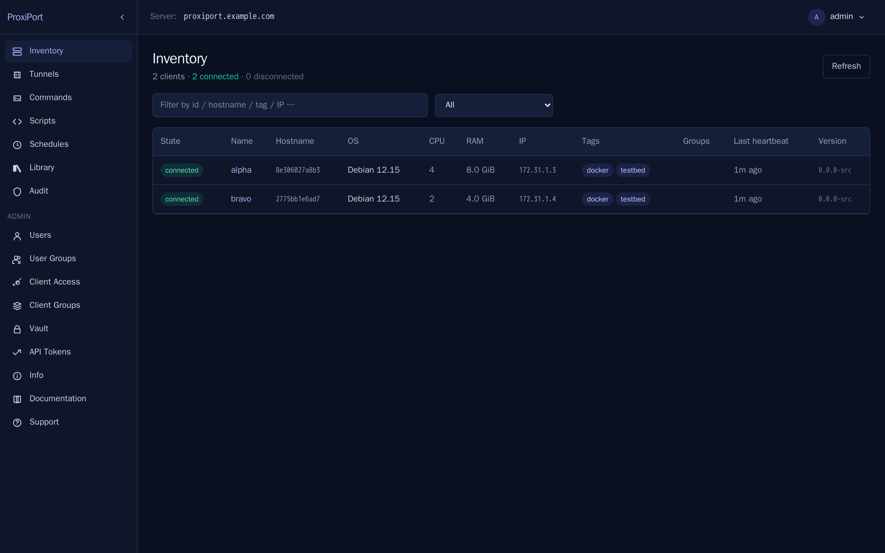

# Install

!!! tip "Just want to see it work?"
    The public demo at
    [`https://demo.proxiport.net/`](https://demo.proxiport.net/) lets
    you sign in (`demo` / `demo`) and explore an Inventory of three
    pre-registered agents without installing anything. State resets
    every hour.

ProxiPort has two pieces: the **server** (`proxiportd`) and the **agent**
(`proxiport`). One server reaches many agents; the agent dials the server
over an outbound WebSocket, so it works behind NAT without inbound
firewall rules.

This page covers a single-server install on Linux and a single Linux
agent. For Windows and macOS agents, see
[Manual install — Windows and macOS](#manual-install-windows-and-macos).

## Server

### Requirements

- Linux x86_64 or arm64 with systemd.
- A public hostname pointed at the host. The **Pick a public listener**
  step below walks through the three TLS setups (built-in ACME, manual
  cert, reverse proxy) — all of them need a hostname.
- Ports 80 and 443 reachable from the network you want agents to
  connect from (80 for the agent listener, 443 for the TLS API).
  Built-in ACME validates over TLS-ALPN-01 on the API's port 443, so
  with that setup 443 must be reachable from the internet.
- SQLite is the default datastore; MySQL is also supported.

### Install

Each release on the
[GitHub releases page](https://github.com/proximile/proxiport/releases)
ships the server for `linux/amd64` and `linux/arm64` in three formats:

- **Debian/Ubuntu `.deb`** — `proxiportd_<ver>_linux_<arch>.deb`
- **Fedora/RHEL/openSUSE `.rpm`** — `proxiportd_<ver>_linux_<arch>.rpm`
- **Tarball** — `proxiportd_<ver>_linux_<arch>.tar.gz`, for other
  distributions

Asset filenames carry the version; the snippets below resolve the
latest tag from the GitHub API before downloading. Substitute `arm64`
for `x86_64` on aarch64 hosts.

#### Debian / Ubuntu

```sh
VER=$(curl -fsSL https://api.github.com/repos/proximile/proxiport/releases/latest \
        | sed -n 's/.*"tag_name": *"\([^"]*\)".*/\1/p')
curl -LO "https://github.com/proximile/proxiport/releases/download/${VER}/proxiportd_${VER#v}_linux_x86_64.deb"
sudo dpkg -i "proxiportd_${VER#v}_linux_x86_64.deb"
```

#### Fedora / RHEL / openSUSE

```sh
VER=$(curl -fsSL https://api.github.com/repos/proximile/proxiport/releases/latest \
        | sed -n 's/.*"tag_name": *"\([^"]*\)".*/\1/p')
sudo rpm -ivh "https://github.com/proximile/proxiport/releases/download/${VER}/proxiportd_${VER#v}_linux_x86_64.rpm"
```

#### Tarball (other distributions)

```sh
VER=$(curl -fsSL https://api.github.com/repos/proximile/proxiport/releases/latest \
        | sed -n 's/.*"tag_name": *"\([^"]*\)".*/\1/p')
curl -LO "https://github.com/proximile/proxiport/releases/download/${VER}/proxiportd_${VER#v}_linux_x86_64.tar.gz"
tar xzf "proxiportd_${VER#v}_linux_x86_64.tar.gz"

sudo install -m 0755 proxiportd /usr/bin/proxiportd
sudo install -d /etc/proxiport
sudo install -m 0640 proxiportd.example.conf /etc/proxiport/proxiportd.conf
sudo install -m 0644 proxiportd.service /lib/systemd/system/proxiportd.service
# The web UI, root-owned where only root can write.
sudo install -d -o root -g root -m 0755 /usr/share/proxiport
sudo cp -r docroot /usr/share/proxiport/docroot
sudo chown -R root:root /usr/share/proxiport/docroot
sudo chmod -R u=rwX,go=rX /usr/share/proxiport/docroot
# The example config ships doc_root commented out; enable it so the
# server serves the web UI.
sudo sed -i -E '/^\[api\]/,/^\[/ s|^[[:space:]]*#?[[:space:]]*doc_root[[:space:]]*=.*|  doc_root = "/usr/share/proxiport/docroot"|' \
    /etc/proxiport/proxiportd.conf

sudo useradd --system --home /var/lib/proxiport --shell /usr/sbin/nologin proxiport || true
# The config will hold key_seed, jwt_secret and both auth pairs.
sudo chown root:proxiport /etc/proxiport/proxiportd.conf
getent group ssl-cert >/dev/null || sudo groupadd --system ssl-cert
sudo install -d -o proxiport -g proxiport -m 0750 /var/lib/proxiport
sudo install -d -o proxiport -g proxiport -m 0750 /var/log/proxiport
sudo setcap CAP_NET_BIND_SERVICE=+eip /usr/bin/proxiportd
sudo systemctl daemon-reload
```

The `ssl-cert` group is listed in the unit's `SupplementaryGroups` so
the daemon can read certbot/manual TLS keys — systemd will not start
the service if the group is missing. `setcap` ships in `libcap2-bin`
(Debian/Ubuntu) or `libcap` (RHEL-family) if your base install lacks
it.

Tarball installs do not generate secrets. `/etc/proxiport/proxiportd.conf`
is the example config, and `proxiportd` refuses to start while any of
these four settings still holds its published example value. Replace
each one before you enable the service:

- `[server] key_seed` (`"<YOUR_SEED>"`): the output of
  `openssl rand -hex 32`. Keep it fixed afterwards: it derives the
  server's SSH host key, which agents pin.
- `[server] auth` (`"clientAuth1:1234"`): the first agent's
  `<client-auth-id>:<password>`, with a strong random password. The
  agent's `auth` setting uses the same pair.
- `[api] auth` (`"admin:foobaz"`): the admin login, `admin:<a strong password>`.
- `[api] jwt_secret` (`"<YOUR_SECRET>"`): a random string, for example
  `openssl rand -base64 24`.

Since no `initial-admin-password` or `initial-client-auth` file is
written, the credentials to use under **Log in** and **Configure the
agent** are the ones you set here.

#### Building from source

If none of the published artefacts fit your platform — or you want a
container image, which we do not publish — build from source:

```sh
go install github.com/proximile/proxiport/cmd/proxiportd@latest
```

The server needs CGO (`CGO_ENABLED=1`) for the embedded SQLite. The
agent is pure Go.

`go install` builds the server binary only. The web UI is a separate
build — `npm install && npm run build` in `frontend/` writes the `build/`
directory that the packages ship as `docroot` — so point `[api]
doc_root` at a copy of it (or at the `docroot` directory from a release
tarball), or the API will answer while the browser gets nothing.

The version string is injected at release time via linker flags, so a
plain `go build` / `go install` reports `0.0.0-src` for
`proxiportd --version` (and `proxiport --version`). That is expected — to
stamp a real version into a source build, pass the ldflag yourself, with
the version of the tag you checked out:

```sh
git checkout v0.12.1
go build -ldflags "-X github.com/proximile/proxiport/share.BuildVersion=0.12.1" \
  ./cmd/proxiportd
```

Stamp a **semantic version** (`x.y.z`, optionally with a `-suffix`), never
a bare commit hash. An agent reports its version on every connection, and
servers up to v0.11.1 refuse an agent whose version they cannot parse from
its second connection onward — such an agent connects once and never
reconnects. The agent logs an error at start when its build version would
not parse.

### Quick setup with `proxiport-setup`

If this is a single-host install with a public hostname pointed at it,
the `proxiport-setup` script bundled with the `.deb` / `.rpm` does
everything below in one command:

```sh
sudo proxiport-setup --fqdn proxiport.example.com
```

It mirrors the upstream openrport curl-bash installer: takes `--fqdn`,
`--email`, `--api-port`, `--client-port`, `--client-url`, `--port-range`,
`--totp` / `--no-2fa`, `--skip-nat` (skip the public-IP check),
`--assume-yes` and `--show-secrets` for unattended runs, and
`--uninstall`; opens UFW or firewalld rules; rewrites `proxiportd.conf` to
bind `:80` for agents and `:443` for the API; turns on built-in ACME if
the hostname is publicly resolvable (or accepts `--cert-file` /
`--key-file` for an existing PEM pair); creates a SQLite
`users`/`groups`/`group_details`/`clients_auth` schema with a
bcrypt-hashed random admin password; enables TOTP 2FA by default;
starts `proxiportd`; and prints the admin URL and credentials.

If that fits your install, jump to **[Log in](#log-in)**. If you want
to lay it out by hand, read on — the remaining sections walk through
exactly what the script automates.

### What just happened

The `.deb` / `.rpm` post-install ran the steps the operator otherwise
has to do manually:

- copied `proxiportd.example.conf` to `/etc/proxiport/proxiportd.conf`
  (mode `0640 root:proxiport`, left alone if it already exists), then
  generated a random ECDSA `key_seed`, JWT signing secret, admin
  password, and first agent credential and wrote them in place of the
  example placeholders;
- enabled `[api] doc_root = "/usr/share/proxiport/docroot"` in that
  seeded config, so the bundled web UI is served as soon as
  `proxiportd` starts;
- recorded the admin and client-auth credentials in two files under
  `/var/lib/proxiport/`:

    ```text
    /var/lib/proxiport/initial-admin-password   # SPA login
    /var/lib/proxiport/initial-client-auth      # first agent's auth pair
    ```

    Both files are mode `0600 proxiport:proxiport` — owned by the
    account the server runs as, so that it can destroy them. Read with
    `sudo cat`. They are **shredded from disk the first time an admin
    logs in with a password**, so retrieve them and store the
    credentials in a password manager before that first login.

    Before 0.10.0 they were `0640 root:proxiport`, which the daemon
    could not open for writing — so the shred failed silently and the
    cleartext credentials stayed on disk. An upgrade re-owns any files
    it finds.

- granted `CAP_NET_BIND_SERVICE` on `/usr/bin/proxiportd` so the
  unprivileged `proxiport` user can bind ports 80 and 443;
- created the `ssl-cert` system group if it was missing (the unit
  lists it in `SupplementaryGroups`);
- created `/var/lib/proxiport` (state) and `/var/log/proxiport` (logs)
  with `proxiport` ownership.

The server is **not yet enabled**. The seeded config binds the API to
`127.0.0.1` only, so nothing is reachable from the network until the
next step (or until you run `proxiport-setup`, which handles all of
this in one shot).

At-rest field encryption is **off by default**, so the seeded
`totp_secret` column, the vault, and the freshly generated `key_seed` /
`jwt_secret` in the config are all stored unencrypted. To wrap them
under a server-held key, configure a `[key_provider]` — see the
`[key_provider]` section of `proxiportd.example.conf`,
[encrypting the config secrets](operator-runbook.md#encrypting-the-config-secrets),
and [Two-factor authentication](api-authentication.md#two-factor-authentication).

### Pick a public listener

The seeded config leaves `[api] address = "127.0.0.1:3000"` so nothing
is exposed off-box until you choose how TLS will be served. There are
three working setups; pick one and edit `/etc/proxiport/proxiportd.conf`
accordingly. Full walk-through with worked examples is in
[HTTPS](https.md).

=== "Built-in ACME (easiest)"

    Single-purpose host with a public DNS A record pointing at it and
    port 443 reachable from the internet, so Let's Encrypt can complete
    its TLS-ALPN-01 challenge against the API listener. `proxiportd`
    obtains and renews the certificate itself. If the API cannot be on
    443, see [HTTPS](https.md#built-in-acme) for the HTTP-01 alternative
    (`[server] acme_http_port`).

    ```toml
    [api]
      address     = "0.0.0.0:443"
      base_url    = "https://proxiport.example.com"
      enable_acme = true
    ```

=== "Manual cert files"

    Bring your own cert + key (certbot --manual, internal CA, anything
    PEM). Both files must be readable by the `proxiport` system user.

    ```toml
    [api]
      address   = "0.0.0.0:443"
      base_url  = "https://proxiport.example.com"
      cert_file = "/etc/proxiport/tls/fullchain.pem"
      key_file  = "/etc/proxiport/tls/privkey.pem"
    ```

=== "Reverse proxy"

    nginx / Caddy / Traefik terminates TLS upstream and forwards plain
    HTTP to `proxiportd` over loopback. Keep `address = "127.0.0.1:3000"`
    in the seeded config and point your proxy at it. See
    [HTTPS](https.md#external-reverse-proxy-in-front) for the directives
    each proxy needs for the WebSocket upgrade.

### Open the firewall

Wherever your server runs there is probably one host-level firewall and
one cloud-level firewall. Both need port 80 (for the agent listener)
and 443 (for the TLS API, which also carries built-in ACME's
validation), unless you went with the reverse-proxy option.

=== "UFW (Ubuntu)"

    ```sh
    sudo ufw allow 80/tcp
    sudo ufw allow 443/tcp
    ```

=== "firewalld (RHEL / Fedora)"

    ```sh
    sudo firewall-cmd --add-service=http  --permanent
    sudo firewall-cmd --add-service=https --permanent
    sudo firewall-cmd --reload
    ```

=== "DigitalOcean / AWS / GCP"

    On hyperscalers the host firewall above only opens the kernel —
    the cloud's network firewall is what the public internet sees. Add
    inbound TCP rules for `80` and `443` to the droplet's Cloud
    Firewall (DO), the instance's Security Group (AWS), or the VPC
    firewall (GCP).

### Enable the service

```sh
sudo systemctl enable --now proxiportd
sudo systemctl status proxiportd
```

If the unit fails to start, `journalctl -u proxiportd -n 50` shows
why — the most common causes are an `[api] address` that's already in
use, a `base_url` whose hostname does not resolve, or `cert_file` /
`key_file` paths the `proxiport` user cannot read.

### Log in

On a package install, read the random admin password generated at
install time (a tarball install uses the `[api] auth` password you set
yourself):

```sh
sudo cat /var/lib/proxiport/initial-admin-password
```

Open `https://<your-host>/` in a browser and sign in, then change the
admin password. How depends on how the server was set up. If you ran
`proxiport-setup`, the admins live in a user database: go to
**Settings → Users**, edit `admin` and set a new password. With the
seeded package config there is a single `[api] auth = "admin:..."`
pair, which can't be changed from the web UI: edit that line in
`/etc/proxiport/proxiportd.conf` and run
`sudo systemctl restart proxiportd`. To manage passwords from the
Users page instead, switch to `auth_file` or `auth_user_table` (see
[API authentication](api-authentication.md#user-stores)).


The **Info** page is where the host-key fingerprint and the
Connect-URL list live — both are needed when configuring agents.


## Agent

### Requirements

- Linux, macOS, Windows, FreeBSD, OpenBSD or NetBSD (see the platform
  list under Install below).
- Outbound TCP from the agent host to the server's `[server]`
  listener — port 80 in the seeded default. Agents never accept
  inbound connections, so no firewall changes are needed on their
  side.

### Install

The fastest way to bring up a new agent is the **pairing service** at
[`pairing.proxiport.net`](https://pairing.proxiport.net/): the operator
posts the agent's credentials, the service mints a one-shot pairing
code, the agent host downloads and runs the installer

```sh
curl https://pairing.proxiport.net/<code> > proxiport-installer.sh
sudo sh proxiport-installer.sh
```

and the installer drops a working binary plus `proxiport.conf` into
place. Installer switches go on the second line, for example
`sudo sh proxiport-installer.sh -o`. Source for the pairing service: <https://github.com/proximile/proxiport-pairing>.

When you generate a pairing code from the web UI, the server brokers the
request: the browser posts to `POST /api/v1/pairing` on your own server
(same origin, using your session), and the server forwards it to the pairing
service. This means pairing works from any deployment's own hostname, and
your server needs outbound network access to `pairing_url` (the
`pairing.proxiport.net` default, or your own instance). Set `pairing_url = ""`
in the `[server]` section to turn pairing off. The **Add credential**
dialog on **Settings → Client Access** then closes once the credential
is created and skips the pairing step, and the server answers
`POST /api/v1/pairing` with `409 ERR_CODE_PAIRING_DISABLED`.

To bring an agent up over Tor or a VPN from the start, the installer takes
`-o` and `-e`; see [Installing with the pairing
script](anonymous-transport.md#installing-with-the-pairing-script).

The agent ships in the same three package formats as the server, plus
tarballs for a wider platform list: Linux (amd64, arm64, i386, armv6,
armv7, riscv64, ppc64, ppc64le, loong64, s390x, and
mips/mipsle/mips64/mips64le hard- and softfloat), macOS (amd64, arm64),
Windows (amd64, as a zip), FreeBSD (amd64, arm64, armv6, armv7, i386),
OpenBSD (amd64, arm64, i386) and NetBSD (amd64, arm64). `.deb` and
`.rpm` are published for every Linux variant.

#### Manual install — Debian / Ubuntu

```sh
VER=$(curl -fsSL https://api.github.com/repos/proximile/proxiport/releases/latest \
        | sed -n 's/.*"tag_name": *"\([^"]*\)".*/\1/p')
curl -LO "https://github.com/proximile/proxiport/releases/download/${VER}/proxiport_${VER#v}_linux_x86_64.deb"
sudo dpkg -i "proxiport_${VER#v}_linux_x86_64.deb"
```

#### Manual install — Fedora / RHEL / openSUSE

```sh
VER=$(curl -fsSL https://api.github.com/repos/proximile/proxiport/releases/latest \
        | sed -n 's/.*"tag_name": *"\([^"]*\)".*/\1/p')
sudo rpm -ivh "https://github.com/proximile/proxiport/releases/download/${VER}/proxiport_${VER#v}_linux_x86_64.rpm"
```

#### Manual install — tarball (other platforms)

```sh
VER=$(curl -fsSL https://api.github.com/repos/proximile/proxiport/releases/latest \
        | sed -n 's/.*"tag_name": *"\([^"]*\)".*/\1/p')
curl -LO "https://github.com/proximile/proxiport/releases/download/${VER}/proxiport_${VER#v}_linux_x86_64.tar.gz"
tar xzf "proxiport_${VER#v}_linux_x86_64.tar.gz"

sudo install -m 0755 proxiport /usr/bin/proxiport
sudo install -d /etc/proxiport
sudo install -m 0644 proxiport.example.conf /etc/proxiport/proxiport.conf
sudo install -m 0644 proxiport.service /lib/systemd/system/proxiport.service

# The agent's own account and directories. `proxiport-agent` is NOT the
# server's `proxiport`: the agent executes operator-supplied commands as its
# own uid, so sharing one account would put it inside the server's trust
# boundary on any host carrying both.
sudo useradd --system --home /var/lib/proxiport-agent \
             --shell /usr/sbin/nologin proxiport-agent || true
sudo install -d -o proxiport-agent -g proxiport-agent -m 0750 /var/lib/proxiport-agent
sudo install -d -o proxiport-agent -g proxiport-agent -m 0750 /var/log/proxiport-agent
sudo chown root:proxiport-agent /etc/proxiport/proxiport.conf
sudo chmod 0640 /etc/proxiport/proxiport.conf
sudo systemctl daemon-reload
```

#### Manual install — Windows and macOS

The agent registers itself with the platform's service manager (the
Service Control Manager on Windows, launchd on macOS) through its
built-in `--service` subcommand. `--service` accepts `install`,
`uninstall`, `start` and `stop`; alongside it, only `--config` and
`--service-user` are honoured.

On Windows, download `proxiport_<ver>_windows_x86_64.zip` from the
release page, unzip it to `C:\Program Files\proxiport\`, and create
`proxiport.conf` next to the binary from `proxiport.example.conf`. Fill
in the three fields described under
[Configure the agent](#configure-the-agent), and under `[logging]`
swap the Linux `log_file` line for the commented
`C:\Program Files\proxiport\proxiport.log` one (the agent does not
start if it cannot open its log file). Then, in an elevated PowerShell:

```powershell
& "C:\Program Files\proxiport\proxiport.exe" --service install --config "C:\Program Files\proxiport\proxiport.conf"
& "C:\Program Files\proxiport\proxiport.exe" --service start
```

On macOS, unpack `proxiport_<ver>_darwin_<arch>.tar.gz`, install the
binary and a config the same way, and run
`sudo proxiport --service install --config <path-to-proxiport.conf>`
followed by `sudo proxiport --service start`. Point `[client] data_dir`
and `[logging] log_file` at directories that exist on that platform.

### Configure the agent

Edit `/etc/proxiport/proxiport.conf` and set three fields:

```toml
[client]
  server      = "your-proxiport-server.example.com:80"
  auth        = "<client-auth-id>:<password>"
  fingerprint = "<server-host-key-fingerprint>"
```

- **`server`** — the address the agent dials. Port should match what the
  proxiportd `[server]` listener was bound to; the seeded default is 80.
- **`auth`** — pull the first credential off the server with
  `sudo cat /var/lib/proxiport/initial-client-auth`, or any later
  credential you've created. Both halves of `<id>:<password>` go in.
- **`fingerprint`** — the proxiportd host-key fingerprint. The server
  logs it every time it starts (look for the line
  `Fingerprint (SHA-256, pin this):`), and the SPA's **Info** page shows
  it too. It stays the same across restarts as long as `key_seed` does
  not change.
  Without it, the agent will accept whatever public key the server
  presents — fine for testing, never for production. Prefer the
  **SHA-256** value (starts with `SHA256:`): the agent matches it in
  full, in constant time. The legacy MD5 colon-hex form still works but
  is deprecated.

Then start the service:

```sh
sudo systemctl enable --now proxiport
```

The agent connects, registers, and waits for tunnel-open requests from
the server. It reconnects automatically.

Refresh the SPA. The new agent shows up in the inventory.



## Upgrading

Install the new package over the old one. The binaries, the unit files
and the bundled SPA are replaced. Your databases and the other server
state in `/var/lib/proxiport` are not moved, and your settings are
kept. The package changes only these things, and only where they still
need it:

- `[api] doc_root` in `proxiportd.conf`, if it is still the shipped
  default (see [Upgrading to v0.11.1 or later](#upgrading-to-v0111-or-later)).
- The two installer credential files under `/var/lib/proxiport`, if
  still present, are handed to `proxiport:proxiport` with mode `0600`.
- When the agent package is installed, `/etc/proxiport/proxiport.conf`
  is set to `root:proxiport-agent` `0640`, and its old default
  `log_file = "/var/log/proxiport/proxiport.log"` and
  `data_dir = "/var/lib/proxiport"` lines are repointed to
  `/var/log/proxiport-agent` and `/var/lib/proxiport-agent`; the
  agent's `state.json` and log file move with them.

=== "Debian / Ubuntu"

    ```bash
    curl -fsSLO https://github.com/proximile/proxiport/releases/latest/download/proxiportd_<version>_linux_x86_64.deb
    sudo dpkg -i proxiportd_<version>_linux_x86_64.deb
    ```

=== "Fedora / RHEL / openSUSE"

    ```bash
    sudo rpm -Uvh proxiportd_<version>_linux_x86_64.rpm
    ```

A service that was running is restarted automatically at the end of the
upgrade; one that was stopped stays stopped. Check it came back:

```bash
systemctl status proxiportd
proxiportd --version
```

!!! warning "Upgrading from v0.8.3 or earlier"
    Packages up to v0.8.3 disabled and stopped both services during
    every upgrade, including unattended ones, and never restarted them
    — the server stayed down until someone noticed. Upgrading *to*
    v0.8.4 still runs the old package's hook, so re-enable it once,
    after which upgrades keep the service running:

    ```bash
    sudo systemctl enable --now proxiportd
    ```

!!! warning "Upgrading from v0.9.x or earlier to v0.10.0: shrink the monitoring log file"
    Before v0.10.0 the server rewrote `monitoring.db` on every start,
    which left a write-ahead log (`monitoring.db-wal`) next to it as
    large as the database itself — gigabytes on a busy fleet. v0.10.0
    stops the rewrite, but it only shrinks a log that is already there
    after its first daily compaction, which happens once the server
    has run for 24 hours without a restart. Shrink it once, by hand,
    right after the upgrade:

    ```bash
    ls -la /var/lib/proxiport/monitoring.db*      # note the -wal size
    sudo systemctl stop proxiportd
    sudo -u proxiport sqlite3 /var/lib/proxiport/monitoring.db \
        'PRAGMA wal_checkpoint(TRUNCATE);'
    sudo systemctl start proxiportd
    ls -la /var/lib/proxiport/monitoring.db*      # -wal is now small
    ```

    The command prints `0|0|0` on success. A first value of `1` means
    the server was still running and nothing was shrunk: stop it and
    run the command again. It needs the `sqlite3` command-line tool
    (`sudo apt-get install sqlite3`, or `sudo dnf install sqlite`).
    The data stays intact: the log is folded into `monitoring.db` before
    it is truncated. Releases after v0.10.0 do this themselves every time
    the server starts, so upgrading straight to one of them needs no
    manual step.

!!! warning "Upgrading an agent from v0.9.x or earlier"
    v0.10.0 gave the agent its own account, `proxiport-agent`, and moved
    its default `data_dir` from `/var/lib/proxiport` to
    `/var/lib/proxiport-agent`. The packages create both. An agent that
    was installed by hand, runs as some other account and has no
    `data_dir` line of its own falls back to the new default after the
    upgrade and refuses to start with an error containing
    `failed to create data_dir "/var/lib/proxiport-agent"` and
    `permission denied`.
    Either set `data_dir` in `[client]` to the directory that account
    already owns, or move the agent to the `proxiport-agent` account as
    shown under
    [Manual install — tarball](#manual-install-tarball-other-platforms).

Downgrading uses the same commands with the older package:
`sudo dpkg -i` with the older `.deb`, or `sudo rpm -Uvh --oldpackage`
with the older `.rpm` (plain `rpm -Uvh` refuses to replace a newer
version). The client
database schema is versioned and migrated forward on start, so a
downgrade across a schema change is not supported — snapshot
`/var/lib/proxiport` first if you intend to go back. Going back below
v0.11.1 also needs `doc_root` set back by hand (see the next section).

## Upgrading to v0.11.1 or later

v0.11.1 moves the bundled web UI out of the server account's data
directory into a root-owned tree, so that a process running as the
server account can no longer rearrange what the next package upgrade
unpacks as root.

- The SPA now lives at `/usr/share/proxiport/docroot` (root-owned,
  read-only for the daemon). The old `/var/lib/proxiport/docroot` is
  removed by the package manager; anything else left there is unused.
- If `[api] doc_root` in `/etc/proxiport/proxiportd.conf` is still the
  shipped default `"/var/lib/proxiport/docroot"`, the package rewrites
  it to the new path. Any other value is left alone; if it still points
  at the old path the upgrade prints a warning and the web UI stays dark
  until you set `doc_root = "/usr/share/proxiport/docroot"` and restart
  `proxiportd`.
- Debian and Ubuntu print `dpkg: warning: unable to delete old directory
  '/var/lib/proxiport': Directory not empty` once during this upgrade.
  That is expected: the old package listed the data directory, the new
  one does not, and the directory holds your state.
- The upgrade restarts a running `proxiportd` at the end, as before. On
  Debian and Ubuntu the old UI files are gone from the moment the package
  is unpacked until that restart, so the web UI returns 404 for a few
  seconds during the upgrade.
- To downgrade to v0.11.0 or earlier afterwards, set `doc_root` back to
  `"/var/lib/proxiport/docroot"` first; the older package installs the
  UI there again but does not edit the configuration.

## Upgrading from a v0.1.2 install

v0.1.3 changes two things that already-running v0.1.2 installs do not
pick up automatically — the package postinstall deliberately leaves an
existing `/etc/proxiport/proxiportd.conf` alone.

- **`[api] address` default moved from `0.0.0.0:3000` to `127.0.0.1:3000`.**
  v0.1.2 servers that have always relied on the example config will
  still listen on 3000 publicly until you switch them onto one of the
  three public-listener profiles above. Until then, the API is reachable
  on plain HTTP, which is exactly what the v0.1.3 defaults are meant
  to stop.
- **Random secrets and initial credential files** are only generated on
  first install. If you set `key_seed` / `jwt_secret` / `[api] auth`
  yourself when bringing v0.1.2 up, nothing to do. If you left them at
  the example placeholders (`<YOUR_SEED>`, `<YOUR_SECRET>`,
  `admin:foobaz`, `clientAuth1:1234`), generate replacements manually
  before upgrading — `openssl rand -hex 32` for the seed,
  `openssl rand -base64 24` for the JWT secret, anything strong for
  the auth strings.

Otherwise the upgrade is `dpkg -i` / `rpm -Uvh` of the new package and
`systemctl restart proxiportd`. Config schema is unchanged.

## Migrating from rport or openrport

ProxiPort's config file format is intentionally compatible with the
upstream `rportd.conf` and `rport.conf`. Tags and option names are
unchanged where the underlying behaviour is unchanged.

To migrate:

1. Stop the upstream service (`rportd` or `openrportd`).
2. Install ProxiPort using the Debian/Ubuntu, Fedora/RHEL, or tarball
   path above.
3. Copy your existing `rportd.conf` to `/etc/proxiport/proxiportd.conf`.
4. Start `proxiportd`.
5. On each agent, replace the upstream binary, copy the config to
   `/etc/proxiport/proxiport.conf`, and start `proxiport`. Re-issue
   the `fingerprint` if the server's host key has changed.

The datastore schema is forwards-compatible from the openrport tree;
ProxiPort runs any pending migrations on first start.

## What does not change from upstream

- **Config file format** — TOML, structurally compatible with
  `rportd.conf` / `rport.conf`.
- **Tunnel transport defaults** — chisel over WebSocket. Serve it
  over TLS in production (built-in `cert_file`/`enable_acme` on the
  server, or an external reverse proxy — see [HTTPS](https.md)).
- **Datastore** — SQLite by default, MySQL supported.
- **REST API surface** — the same `/api/v1/*` routes and
  request/response conventions, with the deliberate exceptions listed
  in [What changed from openrport](changes-from-openrport.md). A few
  endpoints are new (for example `POST /api/v1/pairing`). The OpenAPI
  spec is in the repository under `api-doc/`.
