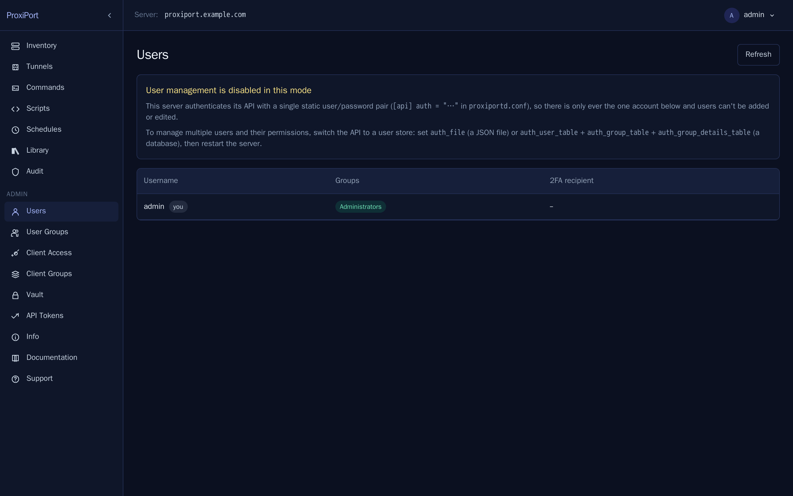
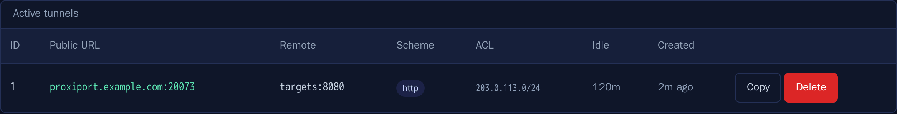
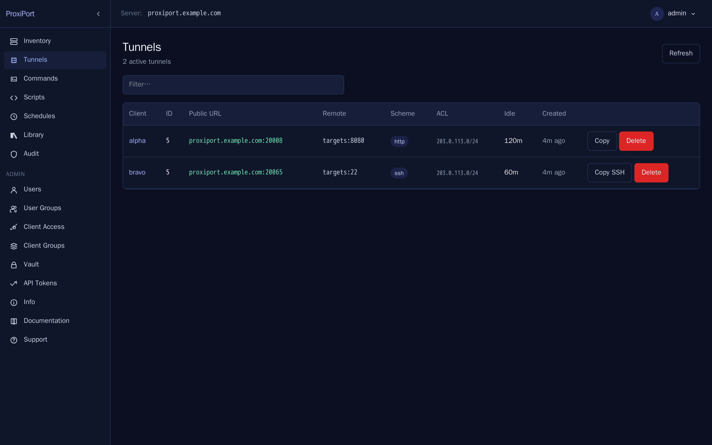
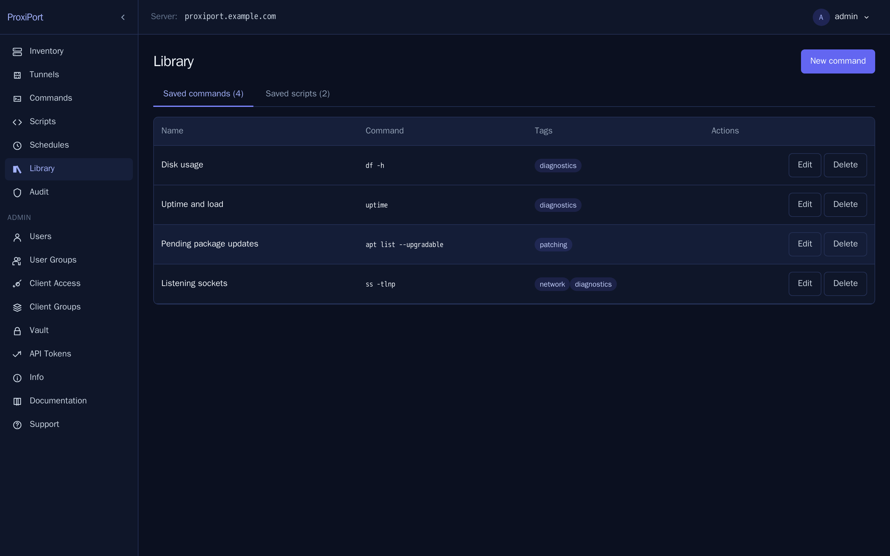
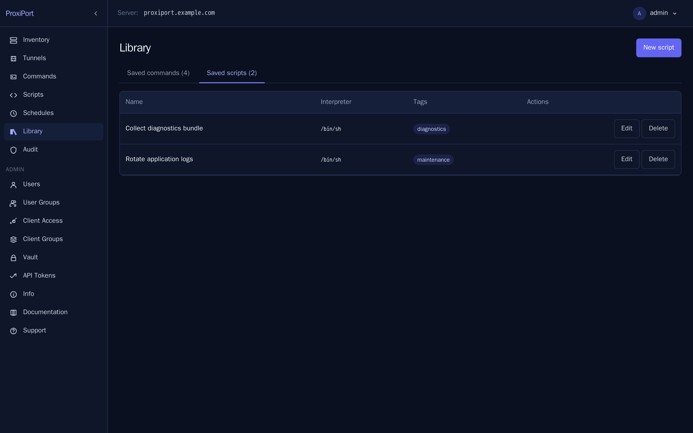
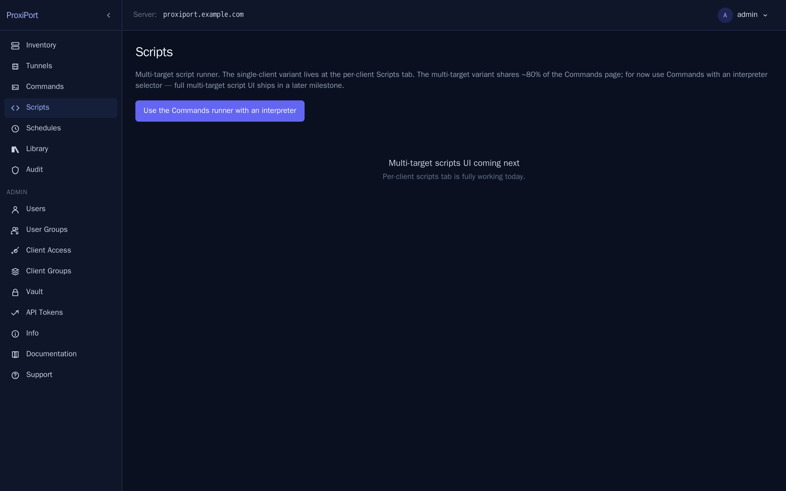
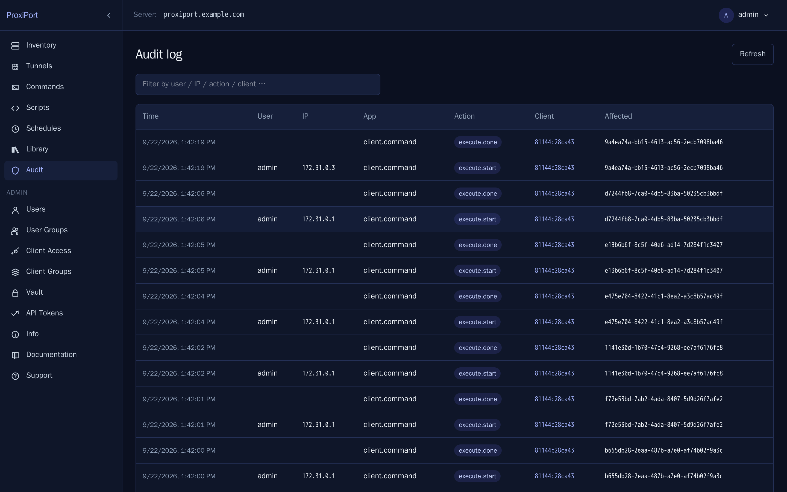
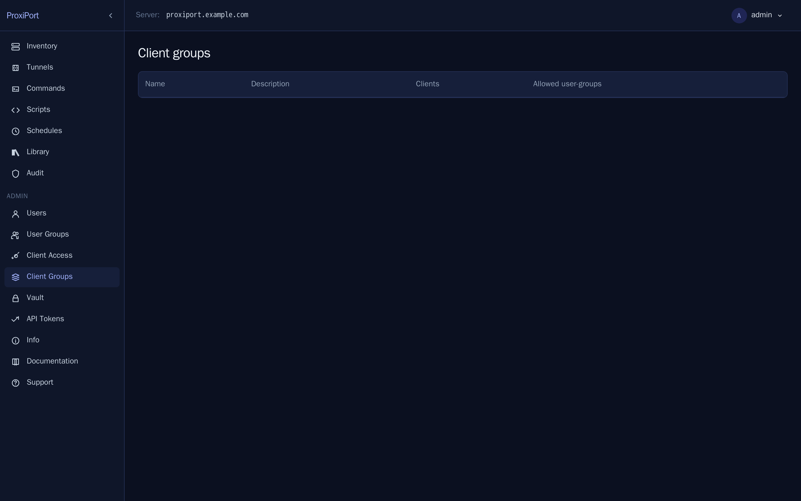

# Operator runbook

Short reference for keeping a ProxiPort server healthy. Not a full
admin guide — see [install](install.md) and [migration](migration.md)
for the first-run setup.

## Service control

```sh
# Server
sudo systemctl status proxiportd
sudo systemctl restart proxiportd
sudo tail -f /var/log/proxiport/proxiportd.log
sudo journalctl -u proxiportd -n 50   # startup failures

# Agent
sudo systemctl status proxiport
sudo systemctl restart proxiport
sudo tail -f /var/log/proxiport-agent/proxiport.log
```

Both programs log to the file set by `[logging] log_file`, and only to
stdout (and so to the journal) when `log_file` is left empty. With the
shipped configs the journal shows service start/stop and errors printed
before the log file is open.

## Paths

| Purpose | Path |
| --- | --- |
| Server config | `/etc/proxiport/proxiportd.conf` |
| Server data | `/var/lib/proxiport/` |
| Server SPA files | `/usr/share/proxiport/docroot/` (root-owned, read-only for the daemon) |
| Server logs (default) | `/var/log/proxiport/proxiportd.log` (`[logging] log_file`; journald only if it is left empty) |
| Agent config | `/etc/proxiport/proxiport.conf` |
| Agent binary (`.deb` / `.rpm` package or tarball) | `/usr/bin/proxiport`, unit at `/lib/systemd/system/proxiport.service` |
| Agent binary (pairing installer) | `/usr/local/bin/proxiport`, unit written by `proxiport --service install` |
| Agent data | `/var/lib/proxiport-agent/` (`[client] data_dir`) |
| Agent log (default) | `/var/log/proxiport-agent/proxiport.log` (`[logging] log_file`; journald only if it is left empty) |

Use the binary path that matches how the agent was installed when you
write sudoers rules, watchdog units or command allow-lists.

## Backups

The server keeps everything that matters in two places:

- **SQLite databases** under `/var/lib/proxiport/`. The set as of
  this writing: `clients.db`, `monitoring.db`, `library.db`,
  `auditlog.db`, `api_sessions.db`, `api_token.db`,
  `client_groups.db`, `jobs.db`, `notifications.db`, and the vault
  store at `vault.sqlite.db`. All of them except the vault store are
  created, with their schema, the first time the server starts
  (`auditlog.db` only while the audit log is enabled);
  `vault.sqlite.db` appears once the vault is initialised. When the
  audit log rotates it also leaves `auditlog.<timestamp>.db` files in
  the same directory, so include those too. Back the directory up
  with a stop-the-world snapshot or with the SQLite `.backup`
  command for hot backups.
- **`/etc/proxiport/proxiportd.conf`** — the config with the
  pinned `key_seed`, `jwt_secret`, and admin credentials. Treat it as
  a secret in its own right, or encrypt those settings — see
  [encrypting the config secrets](#encrypting-the-config-secrets).
- **The at-rest DEK key file** (if `[key_provider] type = "file"`
  is configured) — losing it makes all of this unreadable: the
  encrypted `totp_secret` column, the entire vault, any encrypted
  config setting, stored command and script output in `jobs.db`, and
  the process and mountpoint data in `monitoring.db` (see
  [What else the key provider encrypts](#what-else-the-key-provider-encrypts)).
  Back it up **out-of-band**, not only inside the
  `data_dir` tarball, and ideally keep it off the disk that holds
  the databases.

User auth lives either in a JSON file (`[api] auth_file = "..."`)
or in user and group tables (`[api] auth_user_table` /
`auth_group_table`) in the separate `[database]` connection — a
MySQL/MariaDB database or the stand-alone SQLite file named by
`[database] db_name`, not one of the per-feature files above. Back up
whichever one you use alongside the SQLite files.

Tarball both directories for the simplest backup. Restore by
stopping the service, replacing the directories, and starting again.

The `[database]` section (`db_type = "mysql"` or `"sqlite"`) holds
only the optional API-user (`auth_user_table`) and client-auth
(`auth_table`) tables. It does not replace the SQLite files in
`data_dir`, which still need the backup described above. If you
configured it, back that database up too: with your usual MySQL tooling
for MySQL/MariaDB, or by copying the SQLite file it points to, which
may live outside `data_dir`.

The **vault** is a special case. It is encrypted at rest with a
passphrase that is never written to disk (and, when a `[key_provider]`
is configured, additionally wrapped under the server DEK), so a server
restart always re-locks it — back up `vault.sqlite.db` alongside the
other databases and remember that restoring it requires re-entering the
passphrase through the SPA before the documents and per-client secrets
are readable again. If a key provider was enabled, the restored server
must also present the **same DEK**, or the vault fails closed.


## Encrypting the config secrets

`proxiportd.conf` holds the two most valuable secrets on the box:
`key_seed`, from which the SSH host key every agent pins is derived,
and `jwt_secret`, which signs every API session. Anyone who reads the
file in the clear can stand up a server your agents will trust and mint
admin tokens for your API — from a copy, off your machine, without
touching the running service.

Configure a key provider (the `[key_provider]` section of
`proxiportd.example.conf`) and those settings can live in the config as
ciphertext instead.

With `type = "file"`, create the key so that only its owner can read it:

```bash
(umask 077 && openssl rand -base64 32 > /etc/proxiport/dek.key)
chown proxiport /etc/proxiport/dek.key
```

The `umask 077` is not optional. Without it the default root umask leaves
the key `0644` inside a world-traversable `/etc/proxiport`, which hands
every local account the one key whose whole job is to make a read of the
config and the databases useless. The server **refuses to start** on a key
file that is readable by anyone but its owner, and names the `chmod` that
fixes it.

Encrypt a value with:

```bash
proxiportd -c /etc/proxiport/proxiportd.conf secret encrypt
```

It prompts for the value without echoing it (or reads it from a pipe),
and prints an `enc:v1:…` string. Paste that in place of the plaintext:

```toml
[server]
  key_seed = "enc:v1:0nQxk2…"

[api]
  jwt_secret = "enc:v1:kZ0m9y…"
```

The same works for `[server] auth`, `[api] auth`,
`[database] db_password`, `[smtp] auth_password`, and the `[pushover]`
credentials. Settings without the `enc:v1:` prefix are still read as
plaintext, so a config can be migrated one value at a time, and nothing
breaks if you encrypt none of them.

Two things follow from the DEK being the only way back:

- **Keep the DEK off the machine.** A `type = "file"` key sitting next
  to the config it protects stops nobody who steals the disk. Prefer
  `type = "env"` with the key injected at start (systemd
  `EnvironmentFile` on a `tmpfs`, a secrets manager, your orchestrator).
- **A value the server cannot decrypt stops the server.** Wrong DEK,
  missing DEK, corrupted ciphertext — `proxiportd` refuses to start
  rather than run with a regenerated `jwt_secret` (which would silently
  invalidate every session) or a different host key (which would break
  every agent's fingerprint check). Fix the key, don't work around it.

## What else the key provider encrypts

Enabling a `[key_provider]` also encrypts the recoverable operational
data the server stores, transparently — you read and write it through
the API exactly as before, and only the on-disk databases hold
ciphertext:

- **Command and script output** (`jobs.db`): stdout, stderr and error
  text are encrypted. The command itself and the one-line summary stay
  in the clear so the schedules "last run" view works without the key.
- **Monitoring data** (`monitoring.db`): the process list and mountpoint
  blobs (which can carry command-line arguments and filesystem layout)
  are encrypted.
- **Vault secrets** and **TOTP enrolment seeds**, as covered in
  [vault.md](vault.md) and the two-factor docs.

On the first boot after you enable a key provider, existing plaintext
rows are re-encrypted in place. A stolen database read under the wrong
key (or with none) fails closed — it never returns the ciphertext as if
it were the value. As with the config secrets, this protects a stolen
disk, not a live host that also holds the DEK.

File pushes are staged briefly on disk before agents pull them; that
staging directory (`{data_dir}/filepush`) is created owner-only. For the
strongest guarantee, mount it on a `tmpfs` so payloads never touch
persistent storage.

## Rotating credentials

- **Admin password.** Edit `/etc/proxiport/proxiportd.conf`,
  change the `[api] auth = "admin:<new-password>"` line, restart
  the service. Or, if running a multi-user setup with `auth_file`,
  edit that JSON file or the corresponding DB row.

  The Users page surfaces a banner whenever auth is pinned in the
  config (`[api] auth = "admin:..."`) rather than user-managed —
  rotating in that mode is a config edit + restart, not a SPA action.

  
- **JWT secret.** `[api] jwt_secret = "<long-random-string>"` —
  rotating this invalidates every issued session immediately. All
  users will be redirected to `/auth`.
- **`key_seed`.** Rotating the seed changes the server's SSH host
  key. Every connected agent will fail the fingerprint check
  until its `proxiport.conf` is updated. Avoid rotating unless the
  seed is compromised; coordinate with all agent operators.

  Both of these can be stored encrypted — rotate by writing the new
  value's `enc:v1:…` form into the config, exactly as above.
- **client-auth credentials.** Used by agents to register. Change
  via `[server] auth = "<id>:<password>"` (single credential), or
  via the JSON file pointed at by `[server] auth_file`, or via the
  table named in `[server] auth_table`. Push the new credentials
  to each agent and restart it.

  When the credentials come from `auth_file` or `auth_table` (and
  `[server] auth_write` has not been set to `false`), they can also be
  managed from the SPA at **Client Access**. The single
  `[server] auth` credential is read-only there:

  

- **API tokens.** For programmatic API consumers, mint scoped API
  tokens at **API Tokens** rather than reusing a human's
  username/password. Tokens carry a lifetime and an explicit
  scope (`read`, `read+write`, …) and are revocable independently.

  

  Send a token as HTTP basic auth — your username, with the token as
  the password (`curl -u <username>:<token> …`) — not as a Bearer
  header; see [API authentication](api-authentication.md#personal-api-token).

- **TOTP second factor.** TOTP needs a user store the server can
  write the enrolled secret to: a JSON `auth_file` or the database
  user table, each with a `totp_secret` field (see
  [API authentication](api-authentication.md#two-factor-authentication)).
  It does not work with the single static `[api] auth = "user:password"`
  credential. With such a store in place, set `[api] totp_enabled = true`
  in `proxiportd.conf`, restart, and each user is prompted to enroll on
  their next login. The user scans the SPA's QR with any RFC 6238
  TOTP app:

  

  Admins can require an existing user to re-enroll from the **Users**
  page:

  

  Once enabled at the server, the Info page reflects the new
  posture:

  

  Each user's profile shows their TOTP enrollment state and lets
  them remove their authenticator. Removing it asks for the account
  password; a user who cannot supply it needs an admin to use
  `Reset 2FA` on the **Users** page instead:

  

## Capacity and limits

- **Connected agents per server.** The agent inventory (`clients.db`)
  and the other operational databases (jobs, monitoring, audit log)
  are always SQLite files under `[server] data_dir`. SQLite handles a
  few hundred agents comfortably on modest hardware; to support more,
  give the server faster storage and more CPU. The `[database]` section
  (`db_type = "mysql"`) moves only the API-user and client-auth tables
  to MySQL/MariaDB, not the agent store.
- **Tunnel ports.** `[server] used_ports` controls the pool of
  ports the server may allocate for tunnels. Default `20000-30000`.
  Expand if you run out.
- **Per-user session lifetime.** `?token-lifetime=<seconds>` on
  `/login`; defaults to 10 minutes; the SPA asks for 24 hours.

## Updating

**Package installs** (`.deb` / `.rpm`, the common case): install the
new package over the old one, exactly as in
[Upgrading](install.md#upgrading). The package restarts a running
`proxiportd` itself, runs schema migrations on that first start, and
since v0.11.1 moves the web UI to `/usr/share/proxiport/docroot` and
rewrites a default `doc_root` for you (see
[Upgrading to v0.11.1 or later](install.md#upgrading-to-v0111-or-later)
for what it prints and what to check). Tail the logs afterwards.

**Tarball installs:**

1. Stop the service.
2. Replace the binary at `/usr/bin/proxiportd` (where the tarball
   steps put it) and the web UI under `/usr/share/proxiport/docroot`,
   both root-owned.
3. Start the service. Schema migrations, if any, run on first
   start.
4. Tail the logs to confirm.

For the agent, the same shape applies on each managed host; agents
installed through the pairing service update with its `update` script.

## Tunnels

A tunnel is a per-session listener on the server that forwards
traffic back to a TCP port on the agent. Open one from a client's
**Tunnels** tab.

![Tunnel create form — pick the agent-side address, the public
scheme, and an ACL. The server allocates the public port from
`[server] used_ports` unless you pin it
manually.](screenshots/04-tunnel-create-form.png)

The ACL is enforced at the server's listener, not at the agent —
denied traffic never crosses the chisel session. `Only my current
IP address` is the default preset and uses the address the API saw the
request come from. Behind a reverse proxy that is the proxy's own
address unless the proxy is listed in `[api] trusted_proxies` *and*
sends `X-Forwarded-For` — both halves are needed, see
[IP-address determination](ip-address-determination.md#forwarded-for-handling-on-the-server).
With built-in TLS the connection IP is used directly.



Tunnels also accept inactivity / lifetime caps, after which the
server closes the listener and notifies the agent.


You can save a tunnel definition into the **Stored tunnels**
library to re-open it later in one click.


The global **Tunnels** page is the operator's at-a-glance view
across every connected agent.



### Finding and reusing tunnels from the API

The per-client endpoint `GET /api/v1/clients/{id}` includes that
client's active tunnels by default. The **list** endpoint
`GET /api/v1/clients` returns a lean projection — `id`, `name`,
`hostname` — so request the tunnels field explicitly when you want it
across the fleet:

```
GET /api/v1/clients?fields[clients]=id,name,tunnels
```

This is the same field-projection the list endpoint uses for every
optional attribute: ask for a field and you get it; a client with no
open tunnels reports an empty list. Each tunnel object carries the `id`
you delete it by (`DELETE /api/v1/clients/{id}/tunnels/{tunnelID}`), so
you never have to remember the id from when you created it.

### Tunnels survive an agent restart

When an agent drops and reconnects under the same client id, the server
**re-establishes that client's tunnels automatically** — including a
manually pinned local port — and the restored listener starts carrying
traffic again with no operator action. Because the tunnel is still
there, opening a *new* tunnel to the same agent-side port returns
`ERR_CODE_TUNNEL_TO_PORT_EXIST`. Reuse the existing tunnel (look it up
as above) rather than recreating it; delete it by id first only if you
genuinely want a fresh listener.

## Commands and scripts

ProxiPort can run ad-hoc commands or multi-line scripts against any
connected agent and show the output once each run finishes. What an
agent will run is decided by the `[remote-commands]` block in its
`proxiport.conf`. With the stock config, remote commands are enabled
(`enabled = true`) but filtered: only commands given by absolute path
under `/usr/bin`, `/usr/local/bin` or `C:\Windows\System32` pass the
default `allow` list, and the default `deny` list rejects shell
metacharacters. Set `enabled = false` to turn command execution off
entirely. Agents installed through the pairing service have remote
commands disabled unless the installer was run with `-x`, which
enables them with an unrestricted allow list.


When a command is allowed, the SPA polls the job and, once it
finishes, prints stdout / stderr under the form followed by a
`--- status=successful ---` (or `failed` / `cancelled`) line. If the
command fails, its error (for example `exit status 127`) also appears
in the Error column of the Recent commands table.


Scripts are the same control surface with a multi-line editor and a
free-text Interpreter field, which starts out as `/bin/bash`; enter
any interpreter path (for example `/usr/bin/python3`) or an
interpreter alias defined in the agent's config. The agent writes the
body to a tempfile, executes, and reaps the process.

Script execution is off by default on the agent and is separate from
the command allow list. Set `enabled = true` under `[remote-scripts]`
in the agent's `proxiport.conf` and restart the agent; until then
every script run is rejected. Scripts also need remote commands to be
enabled. An agent installed with the pairing installer's `-x` switch
already has scripts enabled. See [Scripts](scripts.md#enabling-script-execution-on-the-agent).


For repeated patterns, save commands and scripts into the
**Library**:





The Library stores command and script bodies for reuse; it has no run
action of its own. To run a command against several agents at once —
useful for one-shot fleet work — use the **Commands** page: tick the
target agents and type the command, or paste a saved entry's body from
the Library.


The global **Scripts** page is the same concept for whole-fleet
script runs. It is still being reimplemented from the upstream
shape — at the moment it is a stub whose button opens the
**Commands** page, where you can pick an interpreter to run a script
body across several agents. To run a script on a single agent, use
the Scripts tab on that agent's page.



## Schedules

For recurring runs, create a schedule: a cron expression, the target
agents (or client groups), and the command or script body to run. The
body is entered on the schedule itself; schedules do not reference
Library entries, so changing a Library entry does not change a
schedule. The scheduler is in-process; no external cron is needed.


## File transfer

From a client's **Files** tab, upload a file from your browser to a
chosen path on the agent, with optional mode, owner and group, and
options for an atomic (sync) write and force-overwrite. The transfer
goes over the same chisel session as everything else.


## Audit log

Every state-changing API call writes an `auditlog.db` row with the
user, client (if any), action, timestamp, and the request payload.
The per-client view filters the same table down to events touching
one agent:


The global **Audit** page is for cross-cutting queries — who
created which tunnel, who rotated which credential. Reading a vault
secret — the one high-value read worth tracking — is recorded too, as a
`read` action (never the secret itself).

### Tamper-evidence

When a key provider is configured, each audit entry carries a keyed
HMAC chained to the previous entry (the key is derived from the server
DEK and is never stored in the audit database, so someone who has only
the database files cannot recompute it; anyone who can read the DEK —
the `key_file`, or the running server's environment or memory — can).
Editing or deleting a row after the fact breaks the chain. Check it
with:

```bash
curl -s -H "Authorization: Bearer $TOKEN" \
  https://<server>/api/v1/auditlog/verify | jq
```

A `"Valid": true` response means every entry verifies; a break reports
the sequence number and kind (`mac` — a row was edited, `link`/`gap` — a
row was removed or reordered). This detects tampering **on the box**; it
does not stop a host with the DEK from forging new entries — ship entries
to an off-host, append-only sink for that. Rotation starts a fresh chain
per `auditlog.<timestamp>.db` file.



## User and group admin

User groups gate which API endpoints (and therefore which SPA
sections) each user can reach. The built-in `Administrators` group has
every permission set and cannot be edited or deleted. To add a group,
give a user its name on the **Users** page (type it in the group field
and click **Add group**); the group then appears on **User Groups**,
where you tick only the columns the role needs. Permissions can be
edited only with database-backed users and an
`[api] auth_group_details_table`; otherwise the page is read-only. A
user's effective permissions are the union across its groups.


Client groups are rule-based sets of agents: a group's `params` match
client attributes such as client ID, name, hostname, OS or tags, and
every agent that matches belongs to the group. Groups are created and
changed through the API (see
[Client groups and permissions](client-groups-permissions.md#managing-groups-via-the-api));
the SPA's Client Groups page lists them read-only. You can target a
group by passing `group_ids` to the multi-client command and script
API calls, or in a schedule's "Target groups" field. The ad-hoc
Commands page selects targets per client only, and the audit log has
no group filter.



Each user has a profile page (**Settings → Profile**) that shows their
username, group membership and 2FA recipient, and manages their own
TOTP second factor. The web UI has no self-service password change. An
administrator sets a user's password from **Settings → Users**, or a
user can change their own through the API with `PUT /api/v1/me`
(`password` plus `old_password`). With static `[api] auth`, the
password is whatever the config file sets.

![Profile page with TOTP disabled at the server — the two-factor card
names the setting to turn on (`totp_enabled = true` in
`[api]`).](screenshots/31-profile-staticauth.png)

## Common pitfalls

- **`429 too many requests` or `423 Locked` after failed logins.**
  Failed password logins are throttled per source IP plus username:
  after a failed basic-auth or `/login` attempt for a username, further
  attempts for that username from the same address get `429` for
  `[api] user_login_wait` seconds (default 2). Requests with an expired
  or invalid session token, or with no credentials, just get `401` and
  add nothing to that throttle, but every unauthorized request counts
  against the per-IP limit: after `[api] max_failed_login` failures
  (default 10) the address is refused with `423 Locked` for
  `[api] ban_time` seconds
  (default 600). The SPA stops sending API calls once its token is
  gone; if you write your own client, stop retrying on the first `401`
  and re-authenticate, so a burst of rejected calls does not lock out
  your own address.
- **Agent refuses to connect with "fingerprint mismatch".** Either
  the server's `key_seed` changed or the agent's
  `fingerprint = "..."` value is stale. Compare the fingerprint
  printed in the server log at startup against the agent config.
- **SPA shows the vault as locked even after entering the
  passphrase.** Vault passphrases are *not* persisted server-side
  — they live in memory for the life of the process. A server
  restart re-locks the vault. Enter the passphrase again via
  `Settings → Vault`.
- **Server exits with "is still the placeholder from
  proxiport.example.conf".** Since 0.8.8 `proxiportd` refuses to
  start while `[api] jwt_secret`, `[server] key_seed`,
  `[server] auth` or `[api] auth` still holds the value the example
  config ships. Those values are published in the project
  repository, so they are not secrets — a placeholder `jwt_secret`
  in particular becomes the token signing key, and anyone who can
  reach the API can mint an admin token with it. The `.deb` and
  `.rpm` postinstall substitutes all four on first install; a
  tarball, container, or hand-copied config does not. Generate
  them yourself:

    ```sh
    openssl rand -hex 32     # key_seed
    openssl rand -base64 24  # jwt_secret
    ```

    Leaving `jwt_secret` unset is also fine — the server then mints
    a random one at startup, at the cost of logging every user out
    on each restart.

## Where to get help

- File a bug or feature request on the GitHub repository.
- Private vulnerability reports go through GitHub Security
  Advisories — see [`SECURITY.md`](https://github.com/proximile/proxiport/blob/main/SECURITY.md).
